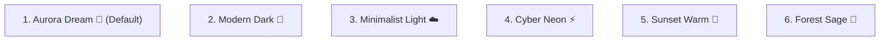

# 🎨 마이링크 (MyLink) 디자인 시스템 & UI/UX 가이드라인 (`docs/design.md`)

> **문서 버전**: v1.0  
> **기준 스택**: Next.js 16, Tailwind CSS v4, shadcn/ui, Radix/Base UI  
> **적용 대상**: 방문자 바이오 링크 페이지 (`/[username]`), 서비스 랜딩 페이지 (`/`), 관리자 대시보드 (`/admin`)

---

## 1. 디자인 비전 및 핵심 원칙 (Design Principles)

1. **Mobile-First & Glanceable (한눈에 들어오는 모바일 경험)**
   - 바이오 링크 유입 트래픽의 90% 이상은 인스타그램, 유튜브, 틱톡 등 모바일 환경입니다.
   - 390px ~ 430px 스마트폰 화면 폭을 최우선 기준으로 하여, 첫 화면(스크롤 전)에 주요 정보(아바타, 이름, 주요 링크)가 한눈에 직관적으로 들어오도록 설계합니다.

2. **Trendy Glassmorphism & Depth (감각적인 글래스모피즘과 공간감)**
   - 배경의 은은한 그라데이션 블러(`backdrop-blur-lg`)와 반투명 경계선(`border-white/20`)을 통해 애플/모던 웹 스타일의 깊이감을 제공합니다.
   - 단조로운 플랫 디자인을 벗어나 콘텐츠가 우아하게 떠 있는 듯한 인상을 심어줍니다.

3. **Tactile Micro-Interactions (만지고 싶은 반응형 인터랙션)**
   - 링크 카드 터치/호버 시 부드러운 스케일 업(`hover:scale-[1.02]`), 클릭 시 눌림 피드백(`active:scale-[0.98]`), 활성 상태를 알리는 펄스 애니메이션 등 생동감 있는 마이크로 인터랙션을 제공합니다.

4. **shadcn/ui 기반 일관된 토큰 시스템**
   - Radix UI / Base UI의 접근성 표준(WAI-ARIA)을 준수하고 Tailwind CSS Variables를 통해 색상, 라운딩, 여백을 일관되게 제어합니다.

---

## 2. 타이포그래피 (Typography)

- **기본 폰트**: Pretendard, System-UI Fallback (`-apple-system, BlinkMacSystemFont, "Segoe UI", Roboto, sans-serif`)
- **타이포그래피 계층 구조**:

| 역할 | 폰트 크기 | Weight | Line Height | 용도 |
|---|---|---|---|---|
| **Display / Name** | 24px ~ 28px (`text-2xl`~`text-3xl`) | `font-extrabold` (800) | 1.2 | 프로필 표시 이름 (`displayName`) |
| **Section Title** | 18px ~ 20px (`text-lg`~`text-xl`) | `font-bold` (700) | 1.3 | 랜딩/대시보드 섹션 타이틀 |
| **Link Card Title** | 15px ~ 16px (`text-base`) | `font-semibold` (600) | 1.3 | 링크 카드 메인 제목 |
| **Subtitle / Bio** | 13px ~ 14px (`text-sm`) | `font-medium` (500) | 1.5 | 한 줄 바이오, 링크 상세 설명 |
| **Badge / Caption** | 11px ~ 12px (`text-xs`~`text-[10px]`) | `font-semibold` (600) | 1.2 | 상태 뱃지, 태그 칩, 푸터 카피 |

---

## 3. 6종 프리셋 테마 컬러 시스템 (Theme Presets)

마이링크는 사용자의 아이덴티티를 1초 만에 바꿀 수 있는 6가지 감성 테마를 제공합니다:

### 테마별 디자인 토큰 명세

| 테마 키 | 테마명 | 배경 스타일 (`bgClass`) | 카드 및 컴포넌트 스타일 (`cardClass`) | 텍스트 & 액센트 |
|---|---|---|---|---|
| **`aurora-dream`** *(기본)* | Aurora Dream | `bg-gradient-to-br from-violet-950 via-purple-900 to-fuchsia-950` | `bg-white/10 border-white/20 text-white hover:bg-white/15 hover:border-pink-400/50 backdrop-blur-lg shadow-lg` | Text: `text-white` Accent: `#ec4899` (Pink) |
| **`modern-dark`** | Modern Dark | `bg-gradient-to-br from-slate-950 via-slate-900 to-indigo-950` | `bg-slate-900/60 border-slate-700/60 text-slate-100 hover:border-indigo-500/80 backdrop-blur-md` | Text: `text-slate-100` Accent: `#6366f1` (Indigo) |
| **`minimalist-light`** | Minimalist Light | `bg-gradient-to-br from-neutral-50 via-gray-100 to-stone-200` | `bg-white/80 border-gray-200 text-gray-900 hover:border-gray-400 shadow-sm backdrop-blur-sm` | Text: `text-gray-900` Accent: `#18181b` (Zinc) |
| **`cyber-neon`** | Cyber Neon | `bg-gradient-to-b from-black via-zinc-950 to-neutral-900` | `bg-black/80 border-emerald-500/40 text-emerald-400 hover:border-emerald-400 hover:shadow-[0_0_15px_rgba(16,185,129,0.3)]` | Text: `text-emerald-400` Accent: `#10b981` (Emerald) |
| **`sunset-warm`** | Sunset Warm | `bg-gradient-to-br from-amber-700 via-rose-800 to-orange-950` | `bg-white/10 border-orange-300/20 text-amber-50 hover:bg-white/15 hover:border-orange-300/40 backdrop-blur-md` | Text: `text-amber-50` Accent: `#f97316` (Orange) |
| **`forest-sage`** | Forest Sage | `bg-gradient-to-br from-emerald-950 via-stone-900 to-teal-950` | `bg-emerald-900/30 border-emerald-800/40 text-emerald-100 hover:border-emerald-600/60 backdrop-blur-md` | Text: `text-emerald-100` Accent: `#14b8a6` (Teal) |

---

## 4. 컴포넌트 디자인 시스템 (shadcn/ui 기반)

### 4.1 링크 카드 (LinkCard)
- **구조**: `[좌: 브랜드 아이콘] + [중앙: 타이틀 및 서브설명] + [우: 강조 뱃지 및 이동 화살표]`
- **버튼 스타일 매트릭스**:
  - **형태 (Shape)**:
    - `pill`: 완전 둥근 타원형 (`rounded-full`)
    - `rounded`: 모던한 둥근 사각형 (`rounded-2xl`)
    - `sharp`: 감각적인 직각 스타일 (`rounded-sm`)
  - **스타일 (Variant)**:
    - `solid`: 테마 액센트 단색 배경 채우기
    - `soft-glass`: 반투명 글래스모피즘 블러 (`backdrop-blur-md`)
    - `outline`: 투명 배경에 외곽선 강조
- **호버/터치 상태**:
  - `transform transition-all duration-300 ease-out`
  - `hover:scale-[1.02] active:scale-[0.98]`
  - 우측 화살표 아이콘: `group-hover:translate-x-1 transition-transform`

### 4.2 프로필 아바타 & 상태 인디케이터 (ProfileAvatar)
- **아바타 링**: 그라데이션 보더 효과 (`p-0.5 bg-gradient-to-tr from-pink-500 via-indigo-500 to-cyan-400 rounded-full`)
- **실시간 활성 뱃지**: 우측 하단 에메랄드 녹색 원형 뱃지 (`w-3.5 h-3.5 bg-emerald-500 border-2 border-slate-900 rounded-full`)
  - 내부 점: `w-1.5 h-1.5 bg-white rounded-full animate-pulse`

### 4.3 뱃지 (Badge)
- **종류**:
  - `Official`: 보라/인디고 톤 (`bg-indigo-500/20 text-indigo-300 border-indigo-400/30`)
  - `Featured`: 핑크/로즈 톤 (`bg-pink-500/20 text-pink-300 border-pink-400/30`)
  - `Contact`: 블루/스카이 톤 (`bg-blue-500/20 text-blue-300 border-blue-400/30`)
  - `New`: 에메랄드 톤 (`bg-emerald-500/20 text-emerald-300 border-emerald-400/30`)
  - `Soon`: 앰버/오렌지 톤 (`bg-amber-500/20 text-amber-300 border-amber-400/30`)
  - `@username`: 상단 핸들 뱃지 (`rounded-full text-xs font-normal`)

### 4.4 퀵 소셜 바 (SocialBar)
- 하단 원형 버튼 모음 (`size="icon"`, `rounded-full`, `hover:scale-110 active:scale-95 transition-all`)
- 브랜드 고유 색상 및 아이콘 (GitHub, YouTube, Instagram, Email, X 등)

### 4.5 바이럴 배너 (Viral Banner)
- 모바일 하단에 부드럽게 노출되는 카드:  
  *"나만의 마이링크 30초 만에 만들기 →"*
- 반투명 글래스 배경에 미세한 테두리 광택 적용

---

## 5. 레이아웃 & 뷰포트 규격

- **모바일 뷰포트 (기준)**:
  - 컨테이너 폭: `max-w-md` (약 448px)
  - 가로 여백: `px-4 sm:px-6`
  - 세로 여백: `py-10 sm:py-14`
- **배경 조명 효과 (Glow Effect)**:
  - 상단 중앙: `w-72 h-72 sm:w-96 sm:h-96 rounded-full blur-3xl pointer-events-none opacity-20`
  - 하단 우측: `w-64 h-64 rounded-full blur-3xl pointer-events-none opacity-15`

---

## 6. 접근성 (A11y) 가이드

1. **명도 대비**:
   - 다크/글래스 테마에서도 WCAG AA 기준(4.5:1 이상)의 텍스트 대비 유지
2. **포커스 링**:
   - 키보드 탭 탐색 시 명확한 아웃라인 링(`focus-visible:ring-2 focus-visible:ring-offset-2`) 노출
3. **새 탭 보안**:
   - 모든 외부 링크는 `target="_blank"` 시 `rel="noopener noreferrer"` 필수 적용
